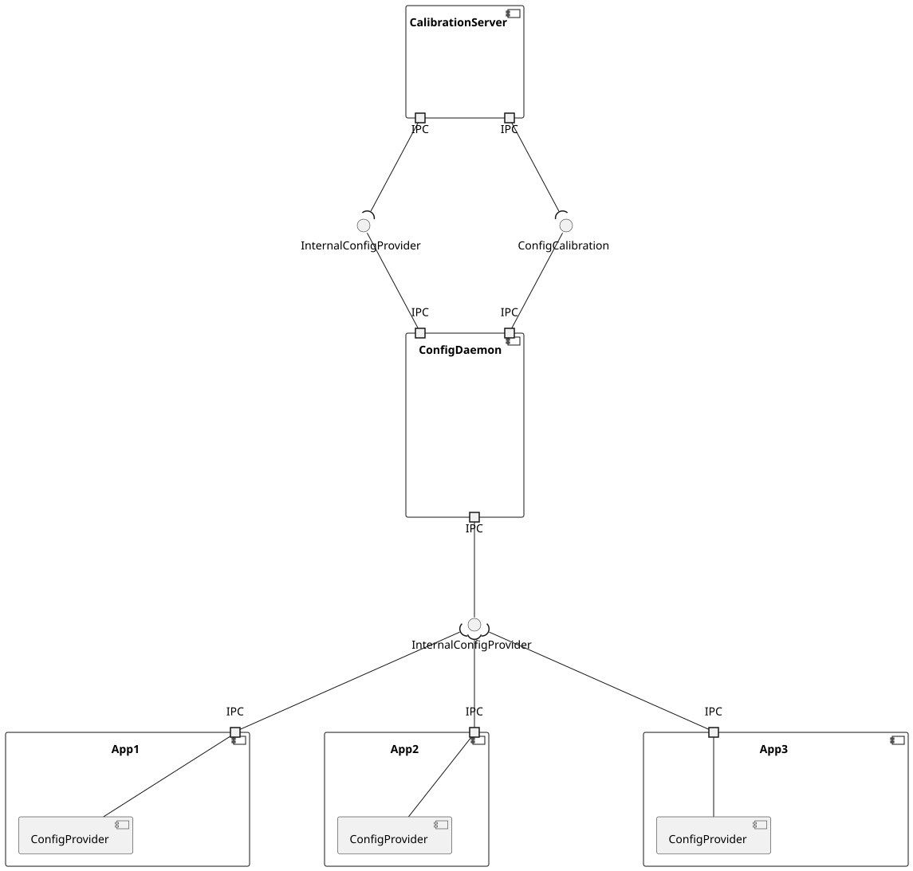
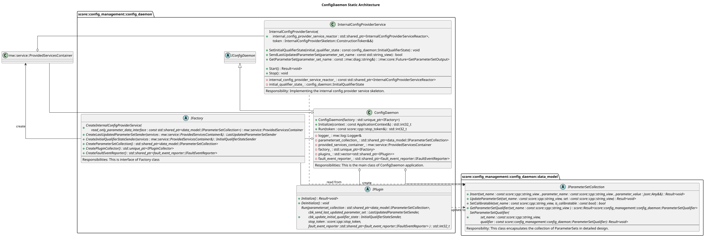
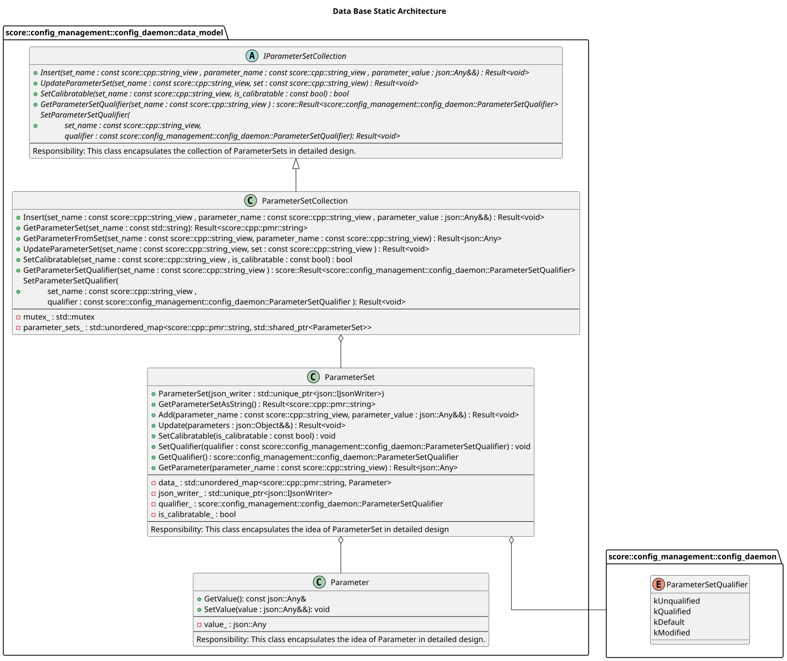
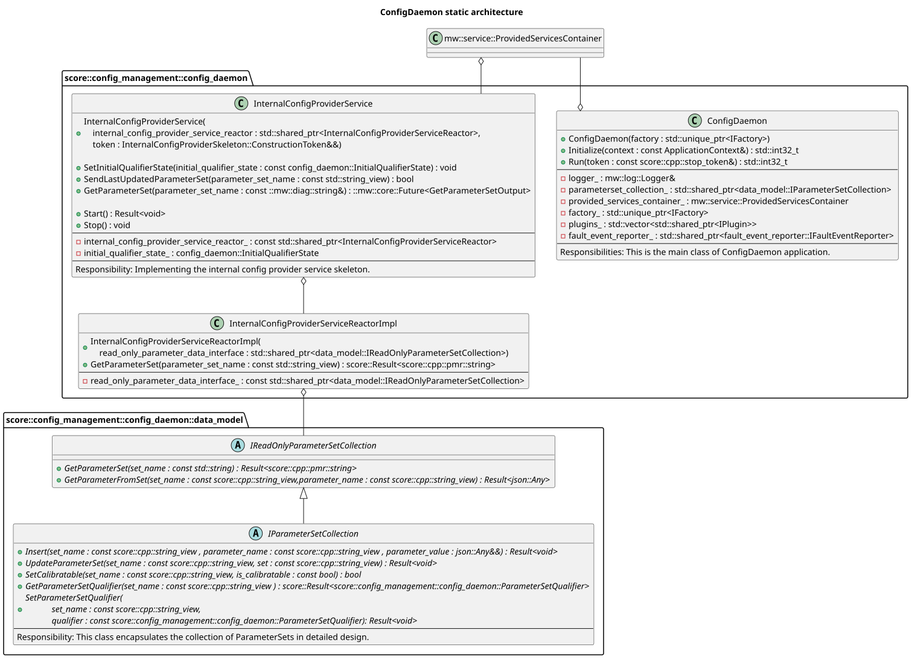
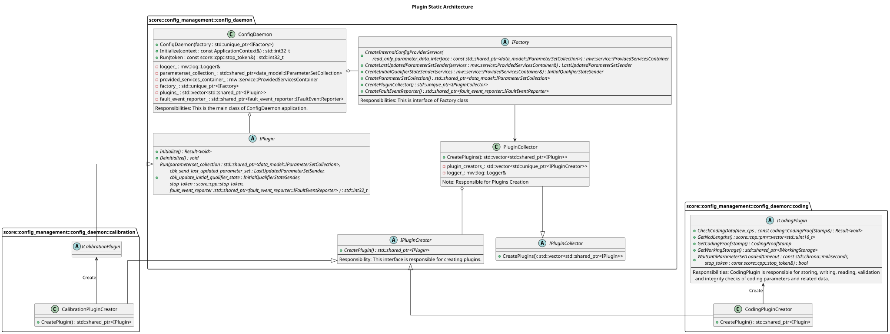
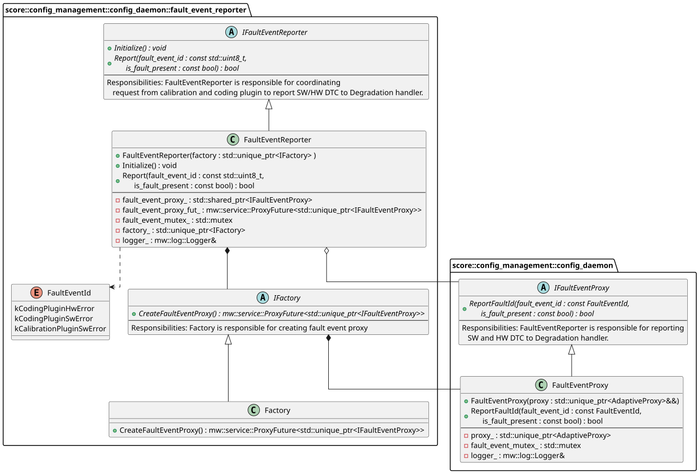
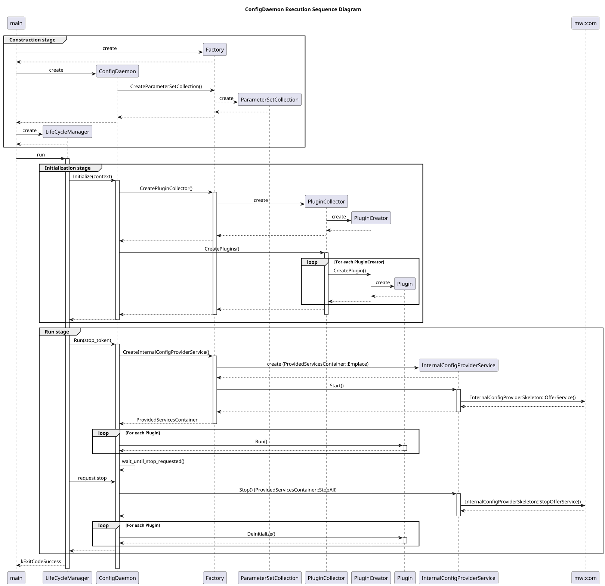
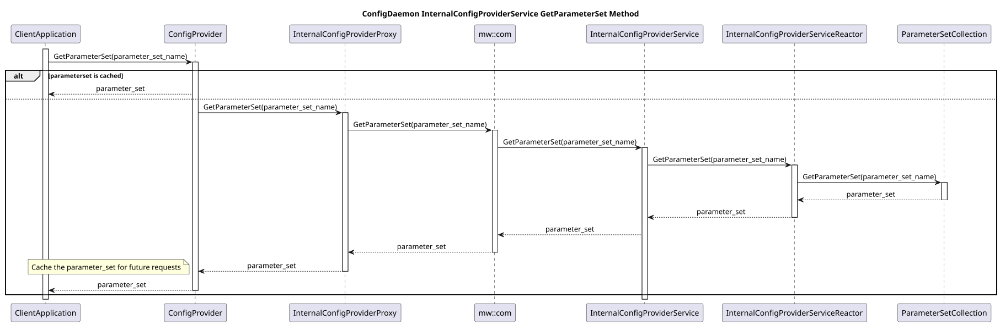
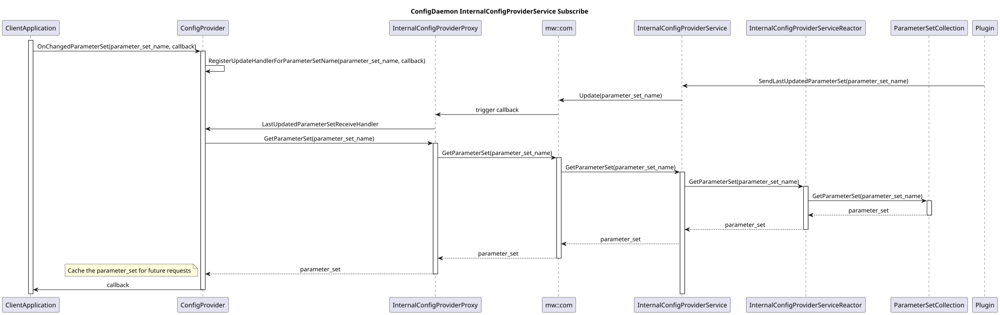

# Detailed Design of ConfigDaemon

## Table of Contents
- [1. Introduction](#1-introduction)
- [2. Description of Interfaces](#2-description-of-interfaces)
  - [2.1 Internal Process Communication Interfaces](#21-internal-process-communication-interfaces)
  - [2.3 C++ Interfaces](#23-c--interfaces)
- [3. Static Architecture](#3-static-architecture)
  - [3.1 Central Database](#31-central-database)
  - [3.2 IPC Interface](#32-ipc-interface)
    - [3.2.1 mw::com Shared-Memory Allocation](#321-mwcom-shared-memory-allocation)
    - [3.2.2 IPC Serialization](#322-ipc-serialization)
  - [3.3 Plugin Mechanism](#33-plugin-mechanism)
  - [3.4 Shared Resources and Fault Event Reporter](#34-shared-resources-and-fault-event-reporter)
- [4. Dynamic Architecture](#4-dynamic-architecture)
  - [4.1 Execution Stages](#41-execution-stages)
  - [4.2 IPC communication](#42-ipc-communication)
- [5. External Dependencies](#5-external-dependencies)

## 1. Introduction

Embedded software typically requires vehicle-specific configuration parameters, such as geometry and geographical region. `ConfigDaemon` application and [`ConfigProvider` library](../../common/ConfigProvider/detailed_design/README.md) together implement a configuration management approach that centralizes storage, verification, and updates, and provides configuration data to client applications.

The diagram below demonstrates the composition principle of `ConfigDaemon` and User Adaptive Applications. The entire communication path between the business logic using a parameter and a parameter stored is encapsulated by `ConfigDaemon` and `ConfigProvider` library. Thus, a user is not directly confronted with the kind of IPC implementation or parameter representation and handling by the interface `IInternalConfigProvider`.

Click to expand SW component view

The design uses a centralized on-target database for all parameters used in an ECU. Clients have read-only access to the database through a generic interface. This supports use cases that rely on flexible [runtime dependencies](./use_cases/README.md#go-for-runtime-dependencies-instead-of-compile-dependencies) rather than static, build-time bindings: an Adaptive Application can access parameters via a generic key–value interface. Compared with statically defined interfaces for each parameter (which must be resolved at build time), this approach reduces build time and avoids architecture model (e.g. FRANCA) changes and rebuilds when parameters change.

Updates to the database are performed exclusively through plugins, which are extensible.

## 2. Description of Interfaces

### 2.1 Internal Process Communication Interfaces

All clients use the generic interface `InternalConfigProvider` to get or subscribe to parameters offered by `ConfigDaemon`.
Find more in [Common InternalConfigProvider description](./README.md#32-ipc-interface).

The interface `ConfigCalibration` provides write access to parameter sets for a `User Adaptive Application` in a generic manner using a key-value principle with `parameter_set_name` as a key and `parameter_set` as a value. See the [fidl](../adaptive_model/interfaces/ConfigCalibration.fidl) file for the interface definition.
`ConfigDaemon` exposes it via mw::com. Therefore, a proxy will be generated on the application side.

The class diagram below depict the relationship between the classes that are used in creating the `ConfigCalibration` service:

Click to expand config calibration service skeleton

### 2.3 C++ Interfaces
C++ interface usage of `ConfigDaemon` is summarized in Chapter [External dependencies](#7-external-dependencies).

## 3. Static Architecture

A general static overview of `ConfigDaemon`:
The core application entry point is the class `ConfigDaemon`. It owns central data storage, offers generic interfaces to client applications, and manages plugins.
It mainly consists of four parts:

1. `Factory`: A factory pattern to improve testability.

2. `ParameterSetCollection`: Encapsulates the central database and stores `ParameterSet` instances as key–value pairs.

3. `InternalConfigProviderService`: The generic service that client applications use to obtain read-only access to the `ParameterSetCollection`.

4. `Plugin`: Components that update the `ParameterSetCollection` according to specific logic.

ConfigDaemon Static Architecture

### 3.1 Central Database

`Parameter` represents a configuration value and contains its content.
Some `Parameter` instances that are closely related are bundled into a `ParameterSet`. A `ParameterSet` is the smallest unit for reading or updating the central database. Each `ParameterSet` also contains a `ParameterSetQualifier`, which indicates the qualification status of the `ParameterSet`. `ParameterSetCollection` encapsulates the in-memory database and provides interfaces to read and update `ParameterSet` instances.

ConfigDaemon DataBase Static Architecture

### 3.2 IPC Interface

`InternalConfigProviderService` binds the underlying IPC technology (e.g. `mw::com`) with composition of class `InternalConfigProviderSkeleton`, which does static polymorphism to template class `mw::com::AsSkeleton` from `mw::com` library. It also owns `InternalConfigProviderServiceReactor`, which implements business logic to retrieve `ParameterSet` instances from the `ParameterSetCollection` via the `IReadOnlyParameterSetCollection` interface.

Besides, `InternalConfigProviderService` also updates the `InitialQualifierState`, see [Details for InitialQualifierState](./plugins/coding/README.md#315-output-interfaces).
The most critical state is `Qualified`, when `InitialQualifierState` assumes this value, applications consuming the data are allowed to assume parameters are safe to be used. As stated in our Safety Goal, we shall never provide corrupted or disqualified data when `InitialQualifierState`=`Qualified`

`ConfigDaemon` uses `Factory` to create `InternalConfigProviderService` and manages it via `mw::service::ProvidedServicesContainer` (from the `mw::service` library), which starts a service as soon as it is added. If the service cannot be started, it is not added and `ConfigDaemon` cannot continue; see the risk described in [4.1 Execution Stages](#41-execution-stages). Client applications use `ConfigProvider` to obtain or subscribe to `ParameterSet` instances from `ConfigDaemon`.

InternalConfigProviderService Static Architecture

#### 3.2.1 mw::com Shared-Memory Allocation

`mw::com` IPC is backed by shared memory (SHM): for a method with dynamically-sized arguments, such as `get_parameter_set` (whose `ParameterSetName` and `ParameterSetContent` arguments vary in length), the proxy allocates SHM for both the method's argument and its return value when it is created. Within that allocation, the actual buffer capacity is only reserved lazily, the first time the method is used - via `ReserveOnce()` - and whatever size is reserved at that point can never be grown afterwards; later calls only `Clear()` and reuse the same buffer. On the proxy side, `InternalConfigProvider::GetParameterSet()` reserves the `ParameterSetName` argument buffer via `ReserveOnce(sizing.max_name_length)` on the first call. On the server side, `InternalConfigProviderService`'s method handler reserves the return-value buffer via `result.ReserveOnce(call_max_payload_size)` on the first call it handles. `ConfigProvider` determines the sizes used for these reservations - `sizing.max_name_length` and `sizing.max_payload_size` - from `buffer_size_report.json` (see [3.2.2](#322-ipc-serialization) below).

- `max_name_length`: the length, in bytes (excluding the null terminator), of the longest `ParameterSetName` among the parameter sets `ConfigProvider` was configured with (see `initial_parameter_set_name_list` in [`buffer_size_report.h`](../../config_provider/code/config_provider/factory/buffer_size_report.h)). It bounds the proxy-side SHM argument buffer used to pass the requested parameter set's name to `ConfigDaemon`. Since each client application configures `ConfigProvider` with its own subset of parameter set names, this value is computed independently per client and can differ between applications.
- `call_max_payload_size`: the worst-case serialized size, in bytes, of a `ParameterSet`'s content, as computed at build time by `buffer_size_calculator` (see [3.2.2](#322-ipc-serialization) below) and reported as `max_payload_size` in `buffer_size_report.json`. It bounds the server-side SHM return-value buffer `InternalConfigProviderService` reserves to hold the `ParameterSetContent` it writes back to the caller, and is passed into the method call by the proxy (as the `call_max_payload_size` argument) so the server knows how much space it has to write into. Like `max_name_length`, this is derived from the calling client's own `initial_parameter_set_name_list`, so it also varies per client application rather than being a single system-wide constant.

Two runtime checks then ensure a single oversized call can never overrun either fixed-size reservation:

1. **Proxy side** (`InternalConfigProvider::GetParameterSet()`): before allocating/populating the method's `ParameterSetName` argument, it checks the requested `set_name` length against `sizing.max_name_length` and fails fast (`ConfigProviderError::kParameterSetNameTooLong`) instead of writing into the SHM pool.
2. **Server side** (`InternalConfigProviderService::Start()`'s method handler): receives the caller's reserved payload size as the `call_max_payload_size` method argument (set by the proxy from the same `shm_sizing`), and compares the parameter set content's size against it before writing the return value; if it would exceed the pool, the handler returns a defined `kParameterSetPayloadTooLargeContent` sentinel instead of overflowing, which the proxy maps to `ConfigProviderError::kParameterSetPayloadTooLarge`.

#### 3.2.2 IPC Serialization

`ParameterSet` instances exchanged over the `InternalConfigProvider` and `ConfigCalibration` interfaces are serialized as JSON. Since `mw::com` is shared-memory-based, the maximum serialized buffer size of a `ParameterSet` must be known at build time and never exceeded at runtime, which in turn requires the serialized size of each value to be a pure function of its compile-time-known data type and array dimensions rather than of its concrete runtime value.

For example, a `uint8` parameter is always budgeted its worst-case width (3 characters, for `255`) regardless of its actual value, so the buffer size of a whole `ParameterSet` becomes the sum of these fixed per-type budgets over its layout, computable at build time without knowing any value. See the [Parameter Set JSON Format Contract](../../docs/ipc_encoding_concepts/parameter_set_json_format_contract.md) for the full size formula and the exact rules this budget relies on.

Three components work together to put this into practice:

- **`type_mapping.json`**: a build-time input file, authored per component, that declares the layout of every `ParameterSet` the component uses - i.e. for each parameter, its `data_type` and `dimensions`. See this [example](../../tools/buffer_size_calculator/example_type_mapping.json).
- **`buffer_size_calculator`**: a Bazel-generated build-time tool that reads one or more `type_mapping.json` files and computes the worst-case serialized buffer size of each declared `ParameterSet`. See its [README](../../tools/buffer_size_calculator/README.md).
- **`ParameterSetJsonSerializer`**: the runtime component that serializes/deserializes `ParameterSet` instances to/from the JSON wire format described above; its output for any value is contractually guaranteed to never exceed the budget computed by `buffer_size_calculator` for the same layout. See [`ParameterSetJsonWriter` vs. Hex Encoding: Safety, Robustness, and Effort Analysis](../../docs/ipc_encoding_concepts/parameter_set_json_writer_analysis.md) for the design rationale.

Computing a build-time budget does not, by itself, guarantee that the shared-memory slot sized to it can never be overrun at runtime - a mismatch between what the size calculator assumes and what the serializer actually writes could still cause an overflow. This is prevented by two independent safeguards: (1) the serializer and the build-time size calculator share the exact same byte-layout rules (number formatting, escaping, array framing), so the computed budget always describes what is actually written, and (2) `ParameterSetJsonSerializer` additionally guards every write at runtime against the remaining buffer space and fails safe - with a defined, detectable error, never a partial or overflowing write - if a mismatch were ever to occur. See [Section 6.1](../../docs/ipc_encoding_concepts/parameter_set_json_writer_analysis.md#61-valid-json-is-not-the-same-as-safe-bounded-serialization) for the full argument.

### 3.3 Plugin Mechanism

`Plugin` components populate or modify the contents of the `ParameterSetCollection`. One `Plugin` is processing parameters of one kind, e.g. either coding parameters or calibration parameters.

`ConfigDaemon` creates plugins indirectly: it uses `Factory` to instantiate a `PluginCollector`, which holds a collection of `PluginCreator` instances. The collectors trigger creators to instantiate the actual `Plugin` objects used by `ConfigDaemon`. This design simplifies adding or removing plugins by changing `PluginCollector` implementations.

`ConfigDaemon` manages plugins through two primary APIs. During initialization, `ConfigDaemon` calls the `Initialize()` function of each plugin to instantiate internal components in a non-blocking manner. During runtime, `ConfigDaemon` calls the `Run()` function of each plugin, passing handles to the `ParameterSetCollection` and to `InternalConfigProviderService` so plugins can update the database and notify clients about parameter and qualifier changes.

Plugin Static Architecture

### 3.4 Shared Resources and Fault Event Reporter

Sometimes `Plugin`s inside `ConfigDaemon` need to share some resource, for example proxy instance or service instance. In the current design of `ConfigDaemon`, these resources need to be instantiated by `ConfigDaemon` and distributed to `Plugin`s via parameters in `Run` function.

`FaultEventReporter` is one of such resource. It is used to report OEM specific faults.

FaultEventReporter Static Architecture

## 4. Dynamic Architecture

### 4.1 Execution Stages

`ConfigDaemon`'s lifetime can be divided into three stages.

1. During construction, the `main` function creates a `Factory` and passes it to the `ConfigDaemon` constructor. Inside the constructor, `ConfigDaemon` uses the factory to create the `ParameterSetCollection`.
2. The `main` function then runs `ConfigDaemon` via the `LifecycleManager` by calling its `Initialize()` function. At this stage, `ConfigDaemon` creates plugins via the factory (as described in 3.3) and triggers non-blocking `Initialize()` calls on them.
3. After successful initialization, `LifecycleManager` calls the `Run()` method of `ConfigDaemon` with a `stop_token` argument. `ConfigDaemon` loads the `ParameterSetCollection` from storage and creates `InternalConfigProviderService` via the factory, which starts and offers it. It then executes the `Run()` functions of the plugins (created during initialization) sequentially. The process blocks indefinitely; `LifecycleManager` can unblock execution using the `stop_token` to enter shutdown sequence. Before returning to `main`, `ConfigDaemon` stops offering `InternalConfigProviderService` and calls the `Deinitialize()` function of the plugins.

If `InternalConfigProviderService` cannot be created or started (for example because offering the service fails), the container returned by the factory is empty. `ConfigDaemon::Run()` then logs an error and returns a failure code before the `Run()` function of any plugin is called. This fail-fast behavior is a deliberate design decision: `InternalConfigProviderService` is mandatory for `ConfigDaemon`, which does not continue without it.

**Risk:** because no plugin is run in this case, the `CodingPlugin` is not executed and coding of the ECU is not possible for as long as the service cannot be offered. The failure ends the whole `ConfigDaemon` process, so the calibration plugin is not run either. This risk is accepted as part of the design decision above.

Execution Sequence Diagram

### 4.2 IPC communication
A client application can request a `ParameterSet` with a timeout in a polling manner. `ConfigProvider` returns the cached value if available; otherwise, it uses the `InternalConfigProviderProxy` to perform IPC with `ConfigDaemon` and retrieve the desired `ParameterSet` from the database.

InternalConfigProviderService Get Sequence Diagram

A client application can also subscribe to a named `ParameterSet` with a callback. If a plugin at the `ConfigDaemon` side updates the `ParameterSet`, an IPC event is sent to `ConfigProvider`. Before invoking the registered callback, `ConfigProvider` instructs the `InternalConfigProviderProxy` to poll the updated `ParameterSet` and update its cache.

InternalConfigProviderService Get Sequence Diagram

## 5. External Dependencies
<!-- TODO: Update the score lib path -->
